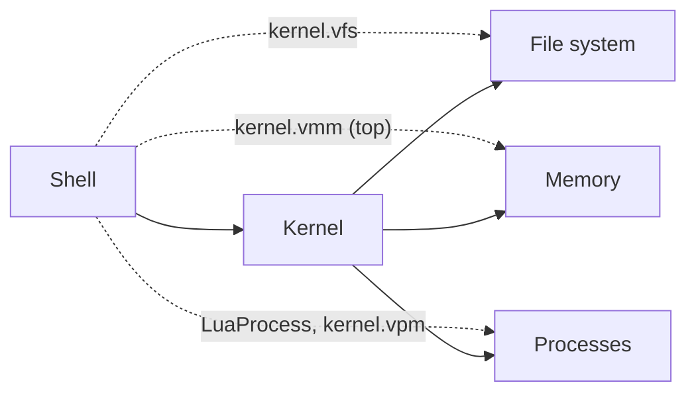

# Context map

The relations between the bounded contexts as they are in the code today. Ownership follows `Shell` → `Kernel` → { `Vfs`, `Vmm`, `Vpm` }: the [Shell](shell.md) owns the [Kernel](kernel.md), which owns the [File system](filesystem.md), [Memory](memory.md) and the process table of [Processes](processes.md).

## Relations

- **Shell → Kernel**: the Shell runs every file operation that touches bytes through `Kernel::write_file` (`write`), `Kernel::read_file` (`read`, `lua`) and `Kernel::remove` (`rm`).
- **Shell → File system**: the Shell also calls the `Vfs` directly through the public `kernel.vfs` field: `cwd` (`pwd`), `change_dir` (`cd`), `list` (`ls`), `create_dir_all` (`mkdir`, and the base tree of `Shell::new`), `create_file` (`touch`, and `/.env`), `file` (the check of `write` before the Editor opens), `resolve` (the name of a Lua process).
- **Shell → Processes**: the Shell spawns and steps `LuaProcess` directly (`lua`), not through the Kernel, and reads `kernel.vpm` for `top`.
- **Shell → Memory**: `top` reads `kernel.vmm` directly (`free_memory`, `total_memory`).
- **Kernel → File system**, **Kernel → Memory**: the Kernel keeps the tree and the bytes consistent: a File's Pages are allocated, replaced and freed only through it.
- **Kernel → Processes**: the Kernel owns `Vpm` (the `vpm` field), and does not call it.

The direct Shell → File system, Shell → Processes and Shell → Memory accesses bypass the Kernel. None of them allocates or frees a Page, so they do not break the consistency the Kernel keeps between the tree and the bytes.

The File system, Memory and Processes do not know each other: a File holds Page addresses as plain numbers, and only the Kernel passes them to Memory.
